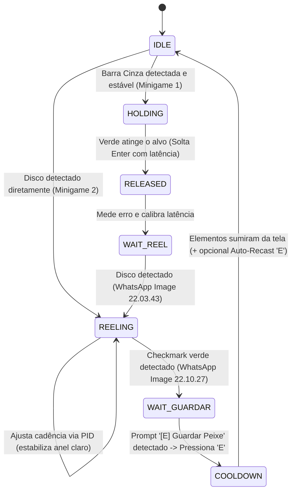

# Contexto do Projeto: Pesca Automática Inteligente (GTA RP / FiveM)

Este documento foi elaborado para fornecer o **contexto técnico completo**, **arquitetura de software**, **modelagem de visão computacional** e **estratégias de controle** para desenvolvedores e agentes de IA que forem manter, aprimorar ou depurar este repositório.

---

## 1. Visão Geral e Objetivo

O projeto é um assistente automatizado (bot/macro de visão computacional) para o sistema de pesca utilizado em servidores de GTA V / FiveM.

O sistema de pesca é composto por **três etapas sequenciais**:

1. **Etapa 1 — Minigame da Barra Vertical (Faixa Cinza)**:
   - Surge uma barra vertical com uma faixa cinza estática em uma posição vertical aleatória.
   - O indicador verde começa a subir pela barra quando `Enter` é pressionado.
   - O bot detecta a posição exata da faixa cinza, pressiona `Enter`, acompanha o topo do verde por regressão linear (posição x tempo) e **solta o `Enter` antecipadamente** compensando a latência do jogo (`calibracao.json`).

2. **Etapa 2 — Minigame do Disco Circular (Recolhimento & Tensão)**:
   - Após a barra cinza, surge um **disco circular escuro central** com um arco verde externo e um **círculo interno brilhante** (anel de tensão).
   - Imagem de referência: `WhatsApp Image 2026-10-16 at 22.03.43.jpeg`.
   - **Dinâmica crucial**:
     - O círculo interno (mais claro) **aumenta ou diminui de acordo com a velocidade e constância dos toques na tecla `Enter`**.
     - **Objetivo do bot**: Manter o raio do círculo interno **o mais estável possível** em torno do alvo (~50% do raio total do disco) usando controle adaptativo de malha fechada (PID).
     - Quando o arco externo fecha e surge o checkmark verde (`FISHING.CAUGHT`), o minigame termina.
     - Imagem de referência: `WhatsApp Image 2026-10-16 at 22.10.27.jpeg`.

3. **Etapa 3 — Prompt de Guardar Peixe (`[E] Guardar Peixe`)**:
   - Assim que o recolhimento termina, o jogo exibe na tela o prompt de interação:
     `[E] Guardar Peixe    [G] Soltar Peixe`.
   - Imagem de referência: `WhatsApp Image 2026-10-16 at 22.29.33.jpeg`.
   - **Ação requerida**: O bot detecta visualmente o momento exato em que esse prompt aparece e **pressiona a tecla `E` para guardar o peixe no inventário** (com failsafe de segurança caso demore mais de 3.5s).

---

## 2. Arquitetura de Software e Máquina de Estados

O bot opera sob uma Máquina de Estados Finitos (FSM) de alta frequência (60-120 FPS):



### Detalhamento dos Estados

1. **`IDLE` (Ocioso / Busca)**:
   - Monitora a barra vertical (Minigame 1) e o disco (Minigame 2) em uma única captura unificada.
   - Se a faixa cinza estiver presente e estável, congela a posição do alvo, pressiona `Enter` e vai para `HOLDING`.
   - Se o disco circular aparecer diretamente, vai para `REELING`.

2. **`HOLDING` (Minigame 1 — Acompanhando Subida do Verde)**:
   - Mede os frames de subida do indicador verde.
   - Ajusta uma reta de regressão linear para calcular a velocidade exata ($v$ em px/s).
   - Prevê o instante exato de chegada ao alvo e agenda a soltura com precisão de microssegundos em $t_{\text{chegada}} - \text{latência}$.
   - Solta o `Enter` e vai para `RELEASED`.

3. **`RELEASED` (Calibração de Latência)**:
   - Espera o verde parar completamente. Mede o erro em pixels ($e = y_{\text{alvo}} - y_{\text{final}}$).
   - Atualiza a latência salva em `calibracao.json` via ganho adaptativo (`CAL_GAIN`).
   - Transiciona para `WAIT_REEL`.

4. **`WAIT_REEL` (Aguardando Disco do Minigame 2)**:
   - Monitora a região central esperando o disco escuro do minigame 2 aparecer (`WhatsApp Image 2026-10-16 at 22.03.43.jpeg`).
   - Transiciona para `REELING` ao confirmar estabilidade de frames.

5. **`REELING` (Recolhimento Ativo com Cadência Inteligente)**:
   - Executa toques rápidos e cadenciados de `Enter` em thread de alta resolução (`AdaptiveTapper`).
   - A cada frame, mede o raio do anel mais claro $r_{\text{anel}}$:
     - Erro: $e(t) = r_{\text{anel}} - r_{\text{alvo}}$
     - Modulação do descanso: $\text{rest} = \text{base\_rest} + K_p \cdot e(t) + K_d \cdot \frac{de(t)}{dt}$
     - Modulação da pressão: $\text{hold} = \text{base\_hold} - K_{p\_hold} \cdot e(t)$
     - Freio emergencial caso o anel ultrapasse 88% do raio do disco.
   - Monitora o núcleo em busca do checkmark verde (`WhatsApp Image 2026-10-16 at 22.10.27.jpeg`). Ao atingir `CHECK_FRAMES`, para os toques e vai para `WAIT_GUARDAR`.

6. **`WAIT_GUARDAR` (Sincronização do Prompt de Guardar)**:
   - Monitora a região de prompt (`guardar_region`) utilizando o `GuardarDetector`.
   - No exato momento em que o prompt `[E] Guardar Peixe` (`WhatsApp Image 2026-10-16 at 22.29.33.jpeg`) é confirmado por template matching normalizado:
     - Envia toque de `E` (100ms de pressão).
     - Transiciona para `COOLDOWN`.
   - Failsafe: se passar 3.5 segundos sem o prompt (ex: UI diferente), aciona `E` automaticamente por segurança.

7. **`COOLDOWN` (Pausa e Próximo Ciclo)**:
   - Aguarda a saída das interfaces da tela para evitar gatilhos duplicados.
   - Se `auto_recast: true` estiver configurado, envia toque adicional em `E` para lançar a vara novamente.
   - Retorna para `IDLE`.

---

## 3. Auto-Detecção de Resolução e Persistência (`config.json`)

Para evitar recalcular e redetectar configurações a cada execução, o módulo [`pesca_config.py`](file:///home/rphmauricio/repos/pesca-duzin/fishing/pesca_config.py) implementa auto-sincronização inteligente:

1. **Leitura da Resolução do Monitor**:
   - Detecta as dimensões atuais da tela primária via `mss` ou API nativa Windows (`GetSystemMetrics`).
2. **Checagem de Perfil Persistido**:
   - Se `config.json` já contém `screen_width` e `screen_height` iguais à resolução atual:
     - Carrega instantaneamente as coordenadas salvas sem recalcular nada.
3. **Escalonamento Automático**:
   - Se a resolução mudou (ex: de 1080p para 1440p ou 720p) ou na primeira execução:
     - Calcula as proporções $s_x = W / 1920$, $s_y = H / 1080$ e $s_r = \min(s_x, s_y)$.
     - Escala proporcionalmente `bar_region`, `disc_region`, `disc_cx`, `disc_cy`, `disc_r` e `guardar_region`.
     - Persiste as novas coordenadas e perfil no `config.json`.

---

## 4. Visão Computacional (CV Pipeline)

### 4.1. Imagens de Referência do Projeto
- **`WhatsApp Image 2026-10-16 at 22.03.43.jpeg`**:
  - Disco circular escuro ($V < 75$), anel claro interno ($H \in [0, 35] \cup [160, 180]$, $S \in [10, 220]$, $V \ge 75$).
  - Gatilho do início da pesca circular.
- **`WhatsApp Image 2026-10-16 at 22.10.27.jpeg`**:
  - Checkmark verde no núcleo ($H \in [35, 90]$, $S \ge 40$, $V \ge 80$, contagem $> 80$ px).
  - Gatilho de conclusão do minigame do disco.
- **`WhatsApp Image 2026-10-16 at 22.29.33.jpeg`**:
  - Badge escuro com letra 'E' e texto `Guardar Peixe`.
  - Gatilho exato para pressionar a tecla `E`.

### 4.2. Captura Unificada de Alta Performance
O bot calcula a união matemática dos três retângulos (`bar_region`, `disc_region`, `guardar_region`):
$$\text{CAPTURE} = \text{bar\_region} \cup \text{disc\_region} \cup \text{guardar\_region}$$
Uma única chamada a `mss.grab(CAPTURE)` captura toda a área relevante em ~2ms, sendo posteriormente fatiada via numpy views em memória contígua.

---

## 5. Estrutura de Arquivos e Scripts

| Arquivo | Descrição |
|---|---|
| [`pesca_auto_corrigido.py`](file:///home/rphmauricio/repos/pesca-duzin/fishing/pesca_auto_corrigido.py) | **Bot completo unificado**: executa Minigame 1 (Barra Cinza) $\rightarrow$ Minigame 2 (Disco Inteligente) $\rightarrow$ Stage 3 (Guardar com 'E'). |
| [`pesca_circulo.py`](file:///home/rphmauricio/repos/pesca-duzin/fishing/pesca_circulo.py) | **Bot direto do minigame circular**: focado no disco com HUD gráfico, cadência PID e detector de Guardar Peixe. |
| [`pesca_config.py`](file:///home/rphmauricio/repos/pesca-duzin/fishing/pesca_config.py) | Módulo compartilhado de auto-detecção de resolução, persistência no `config.json` e `GuardarDetector`. |
| [`config.json`](file:///home/rphmauricio/repos/pesca-duzin/fishing/config.json) | Arquivo central de configurações e coordenadas persistidas. |
| [`Makefile`](file:///home/rphmauricio/repos/pesca-duzin/fishing/Makefile) | Automação de comandos para iniciar, testar e instalar dependências. |
| [`iniciar.bat`](file:///home/rphmauricio/repos/pesca-duzin/fishing/iniciar.bat) | Atalho para iniciar o bot completo no Windows com dois cliques. |
| [`iniciar_circulo.bat`](file:///home/rphmauricio/repos/pesca-duzin/fishing/iniciar_circulo.bat) | Atalho para iniciar direto o minigame circular no Windows. |
| [`requirements.txt`](file:///home/rphmauricio/repos/pesca-duzin/fishing/requirements.txt) | Lista de bibliotecas Python necessárias. |

---

## 6. Comandos e Uso

### Via Makefile
```bash
make run          # Executa o bot completo (Barra + Disco + Guardar Peixe)
make run-circulo  # Executa o bot direto no minigame circular
make test         # Executa a suíte de testes com as 3 imagens de referência
make install      # Instala dependências (pip install -r requirements.txt)
make clean        # Limpa arquivos temporários
```

### Hotkeys de Controle
- **`F6`**: Iniciar / Pausar macro.
- **`F7`**: Armar / Desarmar detecção automática.
- **`ESC`**: Finalizar o macro com segurança e liberação de teclas.

> [!IMPORTANT]
> **Privilégios de Administrador**: No Windows, o terminal ou atalho `.bat` deve ser executado como Administrador para que a injeção de teclas do `pydirectinput` funcione dentro do jogo DirectX.
